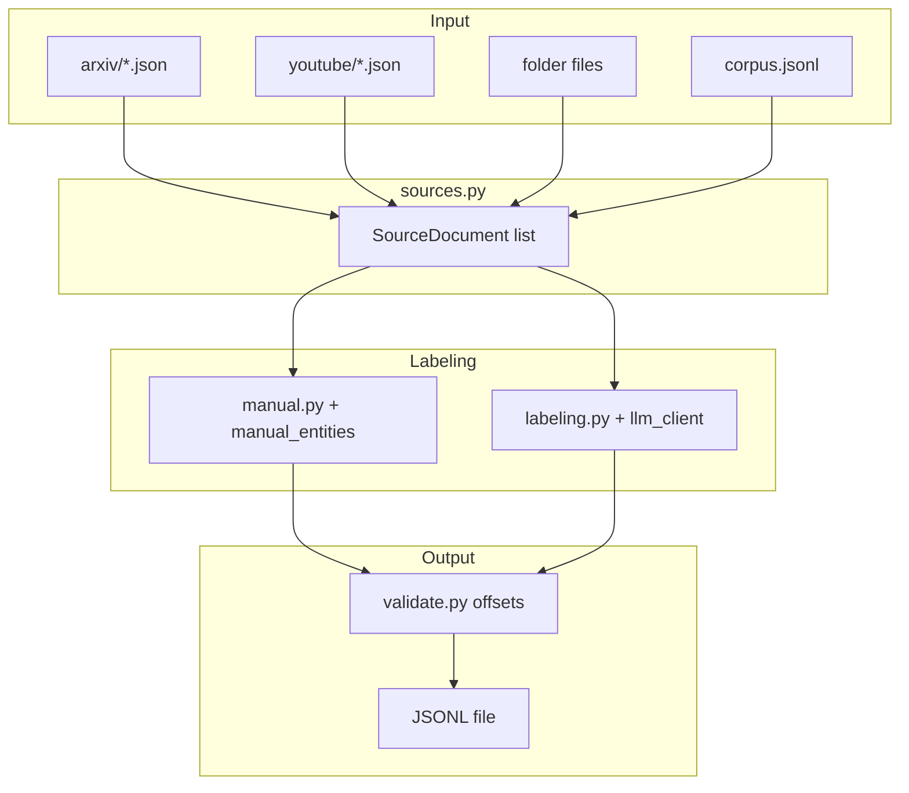

# Architecture

High-level layout of the `ner-gold-generator` package and how data flows through it.

## Package map

```
ner_gold_generator/
  build_gold.py      CLI: load sources → label → write JSONL
  build_arxiv.py     Thin wrapper (arxiv defaults)
  sources.py         Load arxiv / youtube / folder / jsonl → SourceDocument
  manual.py          Resolve manual spans (file + built-in arXiv)
  manual_entities.py Curated arXiv benchmark spans
  labeling.py        LLM multi-sample consensus orchestration
  llm_client.py      OpenRouter + mock chat client
  consensus.py       Majority vote on (text, label) pairs
  validate.py        Label allow-list + substring anchoring
  mock.py            Deterministic mock entities for tests
  types.py           ProposedEntity, ValidatedEntity
  progress.py        stderr progress status lines
  env.py             Load .env once per process
```

## End-to-end flow



1. **`load_documents`** normalizes inputs to `SourceDocument(doc_id, text, source, path?)`.
2. **Manual path:** `resolve_manual_spans` → `_index_entity` via `index_unique_span` (exactly one occurrence).
3. **LLM path:** `label_text_with_llm_consensus` → N × `extract_entities_once` → `consensus_entities` → `validate_proposed_entities`.
4. **`build_gold.main`** serializes rows to JSONL (UTF-8, one object per line).

## Design choices

| Topic | Decision |
|-------|----------|
| Offsets | Computed after labeling, not trusted from LLM |
| LLM hallucinations | Dropped if span not unique substring |
| LLM variance | Multiple passes + majority vote |
| arXiv manual gold | Checked into ner-detector; regenerated from `manual_entities.py` |
| Optional LLM dep | `openai` only in `llm` extra |
| Downstream | ner-detector ignores unknown JSON fields |

## Related repos

| Repo | Role |
|------|------|
| [text-compressor](https://github.com/marfago-labs/text-compressor) | Raw arXiv/YouTube JSON under `data/raw/` |
| [ner-detector](https://github.com/marfago-labs/ner-detector) | Consumes gold JSONL for backend benchmarks |
