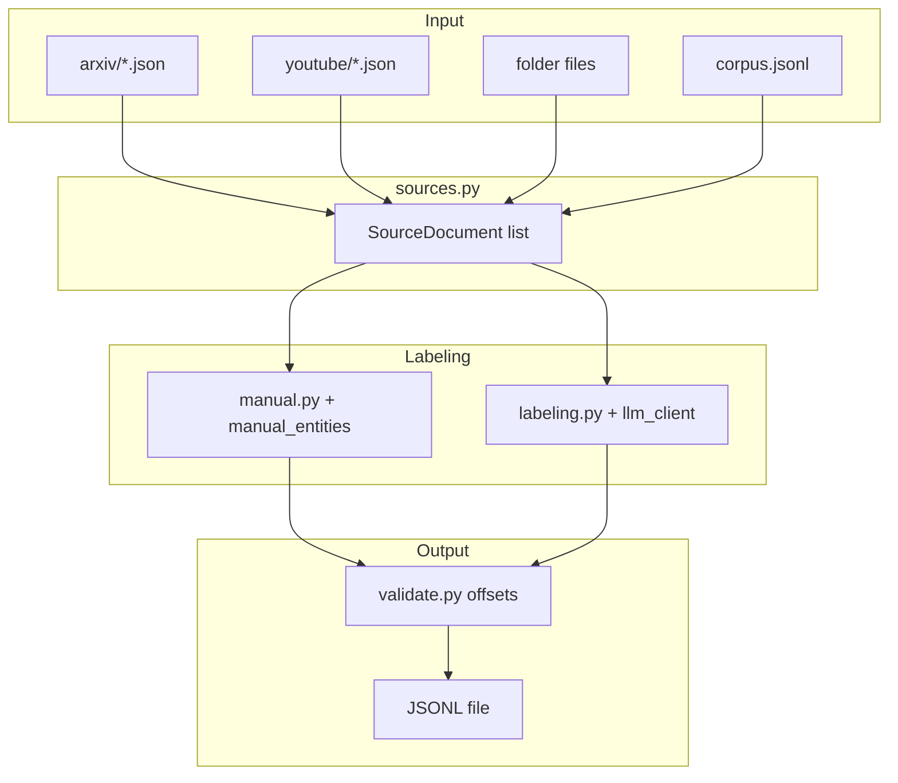
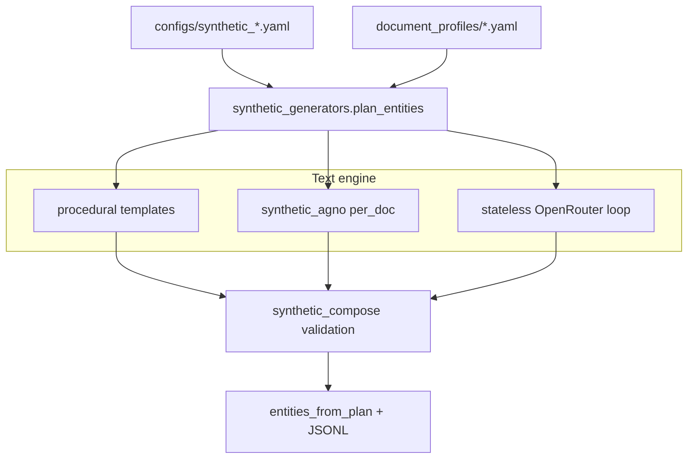

# Architecture

High-level layout of the `ner-gold-generator` package and how data flows through it.

## Package map

```
ner_gold_generator/
  build_gold.py        CLI: load sources → label → write JSONL
  build_arxiv.py       Thin wrapper (arxiv defaults)
  sources.py           Load arxiv / youtube / folder / jsonl → SourceDocument
  manual.py            Resolve manual spans (YAML/JSON file + built-in arXiv)
  manual_entities.py   Curated arXiv benchmark spans
  labeling.py          LLM multi-sample consensus orchestration
  llm_client.py        OpenRouter + mock chat clients (sync and async)
  consensus.py         Majority vote on (text, label) pairs
  validate.py          Label allow-list + substring anchoring
  mock.py              Deterministic mock entities for tests
  types.py             ProposedEntity, ValidatedEntity
  progress.py          stderr / Rich progress helper
  env.py               Load .env once per process
  logger.py            Structured logging to gold.log
  llm_logging.py       Synthetic LLM / Agno trace logging
  synthetic_config.py  Parse configs/synthetic_*.yaml
  document_profiles.py Merge genre overrides (configs/document_profiles/)
  synthetic_generators.py  Plan entity surfaces (deterministic)
  synthetic_compose.py     Procedural text, validation, stateless LLM glue
  synthetic_agno.py        Agno per-document sessions (default LLM path)
  synthetic.py         Orchestrate batch synthetic builds
  build_stats.py       Post-build statistics (lexical diversity, …)
  lexical_diversity.py distinct-1/2 helpers
  interrupt.py         Graceful Ctrl+C for long builds
```

## Corpus labeling flow



1. **`load_documents`** normalizes inputs to `SourceDocument(doc_id, text, source, path?)`.
2. **Manual path:** `resolve_manual_spans` → `_index_entity` via `index_unique_span` (exactly one occurrence).
3. **LLM path:** `label_text_with_llm_consensus` → N × `extract_entities_once` → `consensus_entities` → `validate_proposed_entities`.
4. **`build_gold.main`** serializes rows to JSONL (UTF-8, one object per line).

## Synthetic gold flow (`--source synthetic`)



1. **`load_synthetic_config`** reads YAML (JSON still accepted), inlines prompt files from `configs/prompts/`.
2. For each document, **`sample_document_type`** + **`merge_config_for_profile`** apply genre overrides.
3. **`plan_entities_for_document`** picks labels and surfaces deterministically from seed.
4. **`engine: procedural`** fills templates; **`engine: llm`** calls OpenRouter (Agno `per_doc` by default).
5. Each planned surface must appear **exactly once** in the generated text; gold offsets come from the plan via **`index_unique_span`**, not from LLM NER.
6. Failed documents after retry/replan budgets are **skipped**; others are written to JSONL with `synthetic_meta`.

Logging: aggregate **`gold.log`**; optional per-document files via `llm.document_log_dir` or `--document-log-dir`.

## Design choices

| Topic | Decision |
|-------|----------|
| Offsets | Computed after labeling / planning, not trusted from LLM |
| LLM hallucinations | Dropped if span not unique substring |
| LLM variance | Multiple passes + majority vote (corpus LLM mode) |
| Synthetic spans | Pre-planned surfaces; validate exactly-once before export |
| Transcript genre | Role labels (`Host:`/`Guest:`) separate from planned entity names |
| Config format | YAML under `configs/`; PyYAML is a core dependency |
| arXiv manual gold | Default output `ner-dataset/datasets/arxiv_gold.jsonl`; shipped copy in ner-detector for CI |
| Optional LLM dep | `openai`, `agno`, etc. only in `llm` extra |
| Downstream | ner-detector ignores unknown JSON fields |

## Related repos

| Repo | Role |
|------|------|
| [text-compressor](https://github.com/marfago-labs/text-compressor) | Raw arXiv/YouTube JSON under `data/raw/` |
| [ner-dataset](https://github.com/marfago-labs/ner-dataset) | Canonical gold JSONL output directory |
| [ner-detector](https://github.com/marfago-labs/ner-detector) | Consumes gold JSONL for backend benchmarks |
