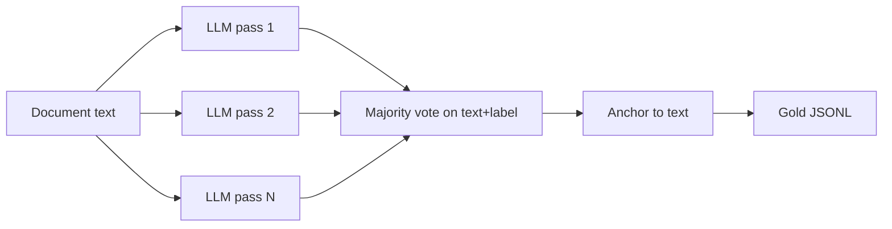

# Labeling modes

Gold entities are produced in one of two modes: **`manual`** (human-curated spans) or **`llm`** (OpenRouter with multi-pass consensus).

## Comparison

| | Manual | LLM |
|---|--------|-----|
| **Labels from** | You (JSON/YAML or built-in arXiv table) | Model + majority vote |
| **API key** | Not required | `OPENROUTER_API_KEY` (or `--mock`) |
| **Non-arXiv sources** | `--manual` file required | Works on any loaded text |
| **Quality control** | Exact span strings you provide | Substring must exist exactly once in text |
| **Typical use** | Benchmark gold you trust | Bootstrapping or large corpora |

---

## Manual mode

### arXiv (built-in)

```bash
uv run build-gold --source arxiv --mode manual
```

Uses `ner_gold_generator/manual_entities.py`: for each paper in `PAPER_ORDER`, curated `(surface text, label)` pairs are located in the abstract and written with `start`/`end` offsets.

Spans must appear **exactly once** in the abstract; otherwise generation fails for that surface.

### Other sources or extra arXiv spans

Provide `--manual path/to/annotations.json` (YAML also supported if PyYAML is installed).

Format:

```json
{
  "arxiv-1706.03762": [
    {"text": "network architecture, the Transformer", "label": "model"}
  ],
  "file-posts/intro.md": [
    {"text": "OpenAI", "label": "organization"}
  ]
}
```

Keys may be full document ids (`arxiv-…`, `file-…`, or jsonl `id`). Bare arXiv ids (`1706.03762`) are accepted for arXiv source.

See [examples/manual-sample.json](examples/manual-sample.json).

Documents without manual entries are **skipped** (logged when progress is enabled).

---

## LLM mode

### Flow



1. **N independent extractions** (`--samples`, default 3; env `LLM_GOLD_SAMPLES`)
2. **Consensus:** keep `(surface, label)` pairs that appear in at least `min_votes` passes (default: majority of N; env `LLM_GOLD_MIN_VOTES=0` means auto majority)
3. **Validation:** drop any span that is not an **exact, unique** substring of the source text (anti-hallucination)

### Invocation

```bash
# Live (set OPENROUTER_API_KEY in .env)
uv run build-gold --source arxiv --mode llm --samples 5 --min-votes 3

# Deterministic tests / dry run
uv run build-gold --source folder --input ./docs --mode llm --mock --limit 2
```

### Model and prompt

- Model: `LLM_GOLD_MODEL` (default `openai/gpt-4o-mini`) via OpenRouter
- Allowed labels: see [Gold schema](gold-schema.md)
- Response must be JSON: `{"entities": [{"text": "...", "label": "..."}]}`

### Output metadata (LLM only)

Extra fields on each JSONL row (ignored by ner-detector):

```json
{
  "gold_source": "llm",
  "llm_meta": {
    "samples": 3,
    "min_votes": 2,
    "per_run_counts": [4, 5, 4],
    "model": "openai/gpt-4o-mini"
  }
}
```

---

## Choosing a mode

- **Reproducible benchmark gold** for arXiv → manual + committed file in ner-detector
- **New corpus (blogs, internal docs)** → start with LLM + human review of JSONL, or manual `--manual` file only
- **CI / unit tests** → `--mock` (no network)
